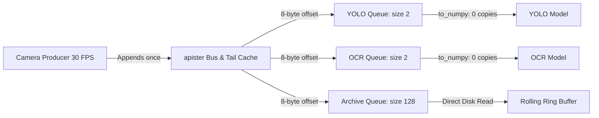
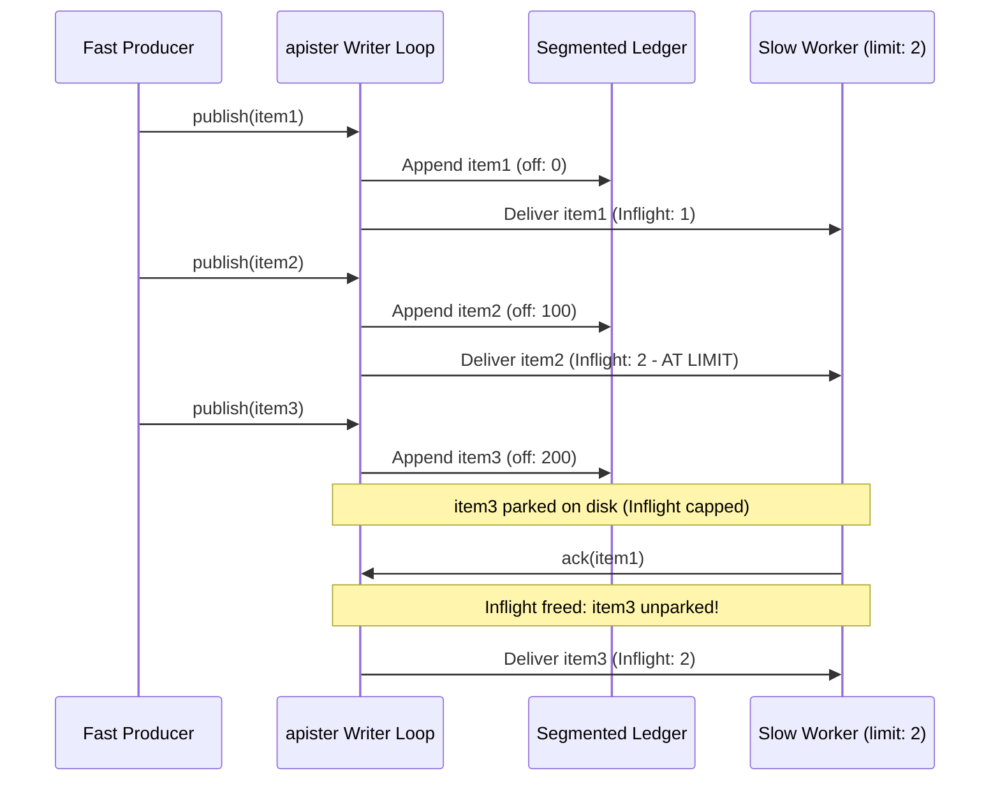

# Apister Architecture & Enterprise System Design Skill

This skill provides system architects, technical leads, and engineering teams with definitive guidance on evaluating, architecting, sizing, and operating **`apister`** in mission-critical applications.

---

## 1. Architectural Mission & System Boundaries

`apister` is an **in-process, high-fan-out publish-subscribe engine** backed by a **crash-durable, segmented on-disk ledger**.

### The Core Problem `apister` Solves
In standard Python event systems, broadcasting large payloads (e.g. 10 MB computer vision frames, 1536-dimensional embedding vectors, or audio PCM buffers) across $N$ subscribers creates $N$ copies of the payload in memory. When fan-out reaches dozens of subscribers, memory usage explodes into gigabytes, triggering severe Garbage Collection (GC) pauses and asyncio event loop freezes.

`apister` decouples payload storage from distribution:
1. Payloads are written **once** to a segmented disk ledger (and an in-memory hot tail cache).
2. Subscriber queues receive only lightweight **64-bit integer byte offsets**.
3. Subscribers slice the payload on-demand via zero-copy buffers (`memoryview`, `to_numpy`).

### Architectural Boundaries Matrix

| Evaluation Dimension | `asyncio.Queue` | `apister` | Distributed Broker (Kafka / RabbitMQ / NATS) |
| :--- | :--- | :--- | :--- |
| **Execution Domain** | In-process only | **In-process (single process)** | Multi-machine / datacenter |
| **Memory Fan-Out** | $O(N \times \text{size})$ (Copies payload) | **$O(1 \times \text{size})$ (Zero memory copy)** | $O(N)$ network serialization & socket writes |
| **Crash Durability** | Non-durable (Lost on crash) | **Durable (Append-only CRC32 ledger)** | Durable (Distributed replicated partitions) |
| **Historical Replay** | Unsupported | **Deterministic replay from offset 0** | Replay via consumer group offsets |
| **Throughput (1 KB Msgs)** | ~250k msgs/sec | **1.26M+ msgs/sec** (Rust) / **322k** (Python) | ~80k-200k msgs/sec (network loopback) |
| **Operational Overhead** | Zero | **Zero (Embedded library, 0 daemons)** | Heavy (JVM, ZooKeeper/KRaft, clustering, ports) |

---

## 2. Six Canonical Enterprise Architecture Patterns

### Pattern 1: Zero-Copy In-Process Fan-Out
**Use Case**: Computer vision, audio DSP studio, multimodal AI, LLM token streaming.
**Problem**: Distributing high-frequency binary frames to multiple models (YOLO, OCR, face detection, archival recorder) stalls the event loop due to memory duplication.
**Solution**:
- Producers publish raw byte frames once.
- Real-time models subscribe with `OverflowPolicy.DROP_OLDEST` and `queue_size=1` or `2`.
- Consumers read via `envelope.memoryview()` or `envelope.to_numpy()`, bypassing Python heap allocation completely.



---

### Pattern 2: Crash-Resilient Local Outbox & CQRS Event Sourcing
**Use Case**: Financial trading bots, desktop/CLI applications, audit logs, database CDC.
**Problem**: When a local application process crashes, uncommitted state in memory is wiped, causing inconsistent business state.
**Solution**:
- All domain state changes are committed first as append-only events to the ledger.
- Read models and projection views subscribe from `replay_from=0`.
- On application restart, projections rebuild their exact state deterministically by replaying from offset 0, guaranteed tamper-evident by CRC32 framing.

---

### Pattern 3: Inflight Backpressure & Multi-Speed Consumer Protection
**Use Case**: RAG ingestion, synthetic data generation, LLM-as-a-judge pipelines.
**Problem**: Fast generation prompts produce data 50x faster than downstream verification models or external vector databases can consume, exhausting host memory.
**Solution**:
- Fast producer runs with `OverflowPolicy.BLOCK`.
- Downstream slow consumer configures `name="indexer"` and `inflight_limit=16`.
- When 16 unacknowledged messages are outstanding, `apister` parks subsequent deliveries on disk. The publisher loop automatically blocks once the command queue fills, propagating backpressure naturally without memory growth.



---

### Pattern 4: Edge-to-Cloud Store-and-Forward Outbox
**Use Case**: Autonomous drones, robotics, connected vehicles, remote IoT gateways.
**Problem**: Devices operate in intermittent connectivity environments. Emitting directly to cloud brokers causes dropped telemetry or thread hangs during network blips.
**Solution**:
- Local sensors continuously log telemetry into `apister` with strict retention limits (`retain_bytes`).
- Attach an external broker bridge (`RedisBroker`, `KafkaBroker`, `RabbitMQBroker`) with an exponential reconnection policy.
- When network drops, local telemetry logs safely to disk. When connectivity returns, the broker bridge replays from its persistent outbox cursor and uploads to the cloud cluster without duplicate deliveries.

---

### Pattern 5: Atomic Batch Pipeline Staging
**Use Case**: Bulk document embedding ingestion, financial market L2 order book updates.
**Problem**: Calling `await bus.publish()` sequentially for 1,000 items in a loop incurs 1,000 asyncio context switches and queue signaling turns.
**Solution**:
- Collect chunks or orderbook ticks into a `list[tuple[str, bytes]]`.
- Call `await bus.publish_many(batch)`.
- The central writer writes and fans out all records in a single disk flush and trie traversal turn, achieving **>1.26M ops/sec**.

---

### Pattern 6: Gap-Safe Out-of-Order Acknowledgments
**Use Case**: In-process worker pools executing variable-duration tasks.
**Problem**: Concurrent workers complete tasks out of sequence. Naive cursors either advance prematurely (risking lost jobs on restart) or stall completely.
**Solution**:
- Consumers process tasks in parallel and call `await sub.ack(envelope)` upon completion.
- `apister` maintains a persistent gap tracker: the on-disk cursor only advances monotonically to the highest *contiguous* acknowledged prefix.
- If the node reboots while tasks 1, 3, and 4 completed but task 2 failed, `apister` automatically redelivers from task 2 upon restart.

---

## 3. Seven Enterprise Anti-Patterns to Avoid

### ❌ Anti-Pattern 1: "The Network Broker Illusion"
* **Mistake**: Attempting to use `apister` directly to communicate between two independent OS processes on different machines or containers without attaching a broker bridge.
* **Why it fails**: `apister` is strictly an **in-process** event bus. Each Python process runs its own isolated writer loop and memory space.
* **Architectural Fix**: Use `apister` inside each process for local high-throughput fan-out, and connect them across nodes via `bus.attach_broker(RedisBroker(...))` or `KafkaBroker(...)`.

---

### ❌ Anti-Pattern 2: "Unbounded Disk Retention"
* **Mistake**: Opening `Bus.open(path)` in production without specifying `retain_bytes`.
* **Why it fails**: Without `retain_bytes`, old sealed segments (`.seg`) remain on disk indefinitely. High-throughput services (e.g. 50 MB/sec) will exhaust host disk space within days, crashing the host OS.
* **Architectural Fix**: Always specify `retain_bytes` to establish an immutable disk quota:
  ```python
  bus = await Bus.open(
      "data/bus",
      retain_bytes=20 * 1024 * 1024 * 1024,  # Cap at 20 GiB
  )
  ```

---

### ❌ Anti-Pattern 3: "Network-Mounted Filesystems for Cursors (NFS/CIFS)"
* **Mistake**: Placing `apister`'s directory on an NFS, CIFS, or SMB shared drive across multiple containers.
* **Why it fails**: Cursor persistence depends on POSIX atomic file replacement (`os.replace`) and synchronous file flushing (`fsync`). Distributed network filesystems frequently violate atomic rename guarantees and exhibit metadata caching delays, risking cursor corruption.
* **Architectural Fix**: Always deploy the ledger directory on **local fast SSD/NVMe or high-speed eMMC** storage.

---

### ❌ Anti-Pattern 4: "Slow Consumer Deadlock without Inflight Limits"
* **Mistake**: Configuring a slow subscriber (e.g. LLM API call taking 2.0s) on an un-capped subscription with `OverflowPolicy.BLOCK`.
* **Why it fails**: The subscriber's queue fills up to `max_queue_size`. Because `OverflowPolicy.BLOCK` is active, the central writer loop pauses waiting for queue slots, halting ALL publishing across ALL topics for the entire application!
* **Architectural Fix**: Always pair slow consumers with an `inflight_limit`:
  ```python
  sub = await bus.subscribe("tasks/heavy", name="llm-worker", inflight_limit=8)
  ```
  `apister` parks excess items on disk, allowing the writer to service other fast topics uninterrupted.

---

### ❌ Anti-Pattern 5: "Payload Duplication on Consumer Materialization"
* **Mistake**: Slicing payloads using `bytes(envelope.payload)` or standard json decoding on multi-megabyte binary payloads.
* **Why it fails**: Defeats `apister`'s zero-copy architecture by allocating full copies on the Python heap, triggering garbage collection spikes.
* **Architectural Fix**: Use `envelope.memoryview()` for slicing headers/structs, and `envelope.to_numpy()` for passing buffers directly to PyTorch, OpenCV, or NumPy.

---

### ❌ Anti-Pattern 6: "Neglecting Host OS Termination Signals"
* **Mistake**: Relying on unhandled `SIGKILL` or container termination without hooking `SIGTERM`.
* **Why it fails**: When killed abruptly, in-flight memory buffers and dirty cursor files may not flush cleanly to disk, requiring recovery truncation and message redelivery on startup.
* **Architectural Fix**: Wire `signal.SIGTERM` and `signal.SIGINT` to `await bus.shutdown()`.

---

### ❌ Anti-Pattern 7: "Wildcard Bridge Loops"
* **Mistake**: Attaching two broker bridges with overlapping wildcard patterns (`#`) on the same topic namespace.
* **Why it fails**: While `apister` prevents echoing incoming broker messages back to other bridges, overlapping subscription patterns on external brokers can create cross-broker routing loops.
* **Architectural Fix**: Segment external namespaces clearly (e.g. `cloud/ingress/#` vs `cloud/egress/#`).

---

## 4. Production Sizing & Capacity Planning Guide

### 1. Daily Disk Growth Formula
$$\text{Daily Growth} = (\text{Messages / Sec}) \times (\text{Average Payload Bytes} + 64) \times 86,400$$

*Example*: 1,000 msgs/sec at 1 KB average size:
$$\text{Daily Growth} \approx 1000 \times 1088 \times 86400 \approx 94.0 \text{ GB / day}$$
*Recommendation*: Set `retain_bytes = 100 * 1024 * 1024 * 1024` (100 GiB) to guarantee a strict 24-hour rolling retention window.

### 2. Tail Cache Sizing Formula
$$\text{Tail Cache} \ge (\text{Peak Ingestion Rate MB/s}) \times (\text{Max Consumer Processing Lag Seconds})$$

*Example*: Ingesting uncompressed camera frames at 30 MB/sec where consumers may lag up to 2 seconds:
$$\text{Tail Cache} \ge 30 \times 2 = 60 \text{ MB} \implies \text{Set } \texttt{tail\_cache\_bytes=64*1024*1024}$$
This guarantees live consumers **never trigger disk reads**.

### 3. Fsync Latency Budget
- **Financial Trading / Audit**: Set `commit_every=1` or `fsync_interval_s=0.002` (2 ms).
- **High-Throughput Telemetry / Vision**: Set `commit_every=256`, `fsync_interval_s=0.01` (10 ms).
- **Batch Processing**: Set `batch_max=256` or `512` and use `publish_many()`.

---

## 5. Architectural Evaluation Checklist

Before approving an `apister` production deployment, verify:
- [ ] Is `retain_bytes` configured to prevent host filesystem saturation?
- [ ] Are slow consumers isolated with explicit `inflight_limit` caps?
- [ ] Is the storage directory hosted on local SSD/NVMe (not NFS/CIFS)?
- [ ] Is `backend="auto"` selected to leverage Rust native acceleration?
- [ ] Do high-frequency publishers use `publish_many()` for batching?
- [ ] Do heavy consumers read via `memoryview()` or `to_numpy()`?
- [ ] Are `SIGTERM` and `SIGINT` signals captured to trigger `await bus.shutdown()`?

